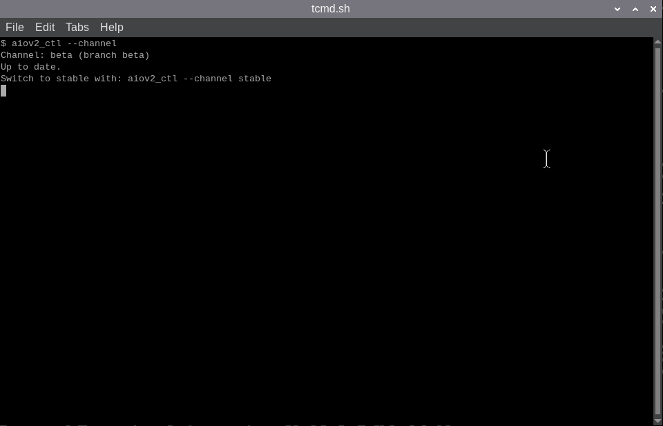
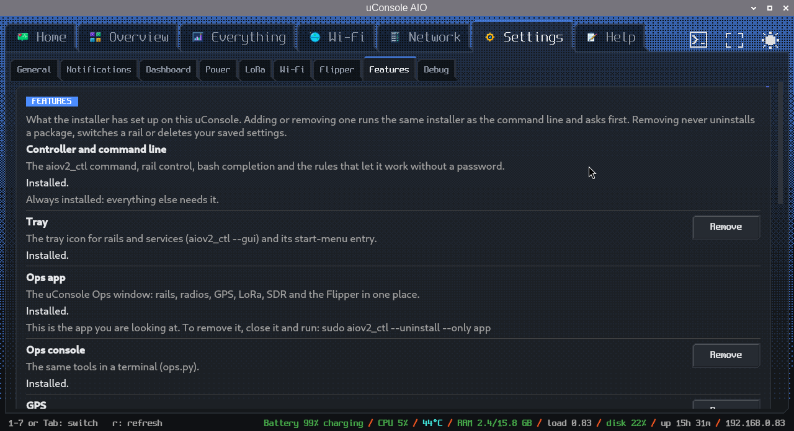

# Updates and Channels

The controller, the tray, the ops app and the ops console are one repository, so they update together, with one request for root.

## Updating

```bash
aiov2_ctl --update
```

Run it as yourself, not with `sudo`. It lists what is waiting, installs it, and keeps the features you have. A tray or ops app that is already open keeps running the old version until you restart it.

In the ops app, Settings, Features has an Update button, and the app shows a notice with "Update now" and "Dismiss" when an update is waiting.

## Channels

| Channel | What you get |
|---|---|
| stable | The tested version. |
| beta | Changes first, before they are well tested. |

See which you are on, and whether anything is waiting:

```bash
aiov2_ctl --channel
```

[](img/install/cli-10-channel.png)

Switch:

```bash
aiov2_ctl --channel beta
aiov2_ctl --channel stable
```

In the ops app: Settings, Features, "Switch to beta".

[](img/app/settings-08-features.png)

Going back to stable returns to the tested version, which is older. What beta set up is not removed. The ops app and console change channel with the rest, since they are in the same checkout.

## Beta and crash reports

Switching to beta in the ops app also turns on saving a crash report on your uConsole if the app crashes. Nothing is sent. You can turn it off in Settings, Debug. See [Reporting Problems](Reporting-Problems).
